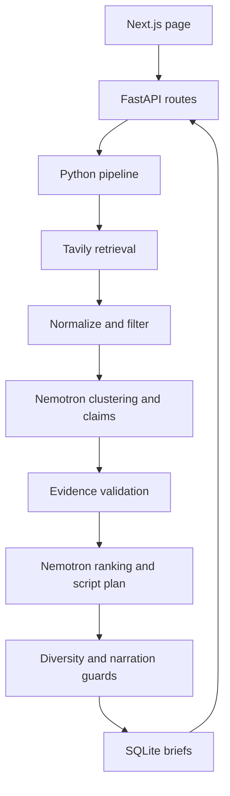

# DayBrief

A local news briefing prototype for the Nebius × NVIDIA Global AI Hackathon.
Choose General, AI & Technology, or Science to generate three source-backed event
cards and a roughly one-minute narration. Python 3.12, FastAPI, Pydantic v2,
SQLite, and Next.js with TypeScript. No agent framework or video generation.

## Quick start

Requirements: Python 3.12+, Node 20.9+, npm, and network access for dependencies.

```bash
./dev.sh
```

Open http://localhost:3000; API docs: http://localhost:8000/docs.
The script creates a virtual environment, installs dependencies, and copies the
example environment into backend/.env **only when that file does not exist**.
The example explicitly enables mock mode. Existing settings are preserved.
Mock articles are fictional, timestamped relative to generation time; their
`.example` URLs intentionally do not resolve. The visible mock label distinguishes
these from real reporting. No paid requests are made in mock mode.

Manual setup (two terminals):

```bash
python3.12 -m venv .venv
.venv/bin/pip install -e './backend[dev]'
cp .env.example backend/.env
cd backend
../.venv/bin/uvicorn daybrief.api:app --reload
```

```bash
cd frontend
npm ci
# Optional: set NEXT_PUBLIC_API_BASE_URL in .env.local before build/dev.
npm run dev
```

## Configuration

Backend reads environment variables and `.env` in its working directory.
Without explicit configuration, mode is **real**, with a clear 503 error when
credentials are missing. Never put keys in frontend variables or commit `.env`.

| Variable | Meaning |
| --- | --- |
| DAYBRIEF_MODE | Explicit `mock` or `real`; code default is `real` |
| TAVILY_API_KEY | Tavily API credential, backend only |
| TAVILY_BASE_URL | Tavily API root, default https://api.tavily.com |
| NEBIUS_API_KEY | Token Factory key, backend only |
| NEBIUS_BASE_URL | OpenAI-compatible API root ending in `/v1` |
| NEBIUS_MODEL | Model ID available to your Token Factory account |
| NEWS_LOOKBACK_HOURS | Default window, 24; 1–168 hours |
| DATABASE_URL | SQLite URL; default sqlite:///./daybrief.db |
| REQUEST_TIMEOUT_SECONDS | Timeout for each provider request, default 45 |
| CORS_ORIGINS | Comma-separated allowed origins; default http://localhost:3000 |
| NEXT_PUBLIC_API_BASE_URL | Frontend backend URL; default http://localhost:8000; embedded at build time |

For real mode, set `DAYBRIEF_MODE=real`, supply both keys, and confirm endpoint
and model availability in Token Factory. The example uses the endpoint and model
shown in [Nebius's official Nemotron example](https://nebius.com/services/token-factory/nemotron):
`https://api.tokenfactory.us-central1.nebius.com/v1` and
`nvidia/nemotron-3-super-120b-a12b`. Bearer auth and OpenAI-compatible
`/chat/completions` are used. No endpoint/model is guessed by the code.

[Tavily's official Search API](https://docs.tavily.com/documentation/api-reference/endpoint/search)
is called with Bearer auth, news topic, a date boundary, and publication dates.
The application applies the exact rolling hour window after retrieval. Missing,
invalid, or timezone-naive publication timestamps are discarded; retrieval time
is never substituted for publication time.

## Architecture



- `adapters.py`: provider transport, bounded retries, validated model responses;
  mock adapters return stage outputs, never a preassembled brief.
- `pipeline.py`: normalization, date filtering, clustering, extraction,
  verification, ranking, diversity selection, and narration assembly.
- `models.py`: forbidden extra fields, constrained enums/scores, HTTP URLs,
  timezone-aware dates, exactly three selected events.
- `storage.py`: SQLite transactions and parameterized queries, no model calls.
- `api.py`: endpoints, explicit provider/configuration/storage errors and CORS.

Nemotron is central: it resolves event clusters, extracts and classifies claims,
assesses importance, and selects claim indices for the narration. Python checks
all outputs and applies editorial constraints. The script is assembled from
verified selected claims, rather than trusting unrestricted generated prose.
All claims retain source URL mappings; sources retain their timestamps and original
URLs in `original_url` alongside the normalized URL used for deduplication.

The conservative support gate requires each claim's exact text to occur in cited
snippets. Two distinct source hostnames are required to narrate it as a confirmed
fact. Single-source claims are downgraded and marked insufficiently corroborated.
Unsupported claims are retained for audit but excluded from the summary/narration.
`why_it_matters` is explicitly displayed as analysis. Sensitive keywords can raise
sensitivity independent of the model. Sensitive narration and card text are
checked for overt humor/exclamation markers and rejected when found. These
lexical checks cannot reliably detect every form of sarcasm.

## API

```bash
curl -s http://localhost:8000/health
curl -s http://localhost:8000/api/topics
curl -s http://localhost:8000/api/briefs/generate \
  -H 'Content-Type: application/json' \
  -d '{"topic":"ai_technology","lookback_hours":24}'
curl -s http://localhost:8000/api/briefs/BRIEF_ID
```

Success returns a validated Brief including events, claims, citation metadata,
script, estimated duration and mode. Invalid requests return 422 with FastAPI's
validation details; unavailable configuration/storage returns 503; provider or
editorial failures return 502; absent brief IDs return 404. Application errors use
`{"error":{"code":"...","message":"..."}}`. Provider secrets and raw
responses are never included in errors. Retries: up to three HTTP attempts for
network/timeouts/429/5xx with 0.25/0.5-second backoff; invalid model schemas get one
explicit retry, then fail. Authentication errors are not retried.

## Checks and builds

```bash
cd backend
../.venv/bin/ruff check .
../.venv/bin/ruff format --check .
../.venv/bin/pytest -q
```

```bash
cd frontend
npm run lint
npm run typecheck
npm run build
npm start
```

Optional browser smoke test (after building):

```bash
cd frontend
npx playwright install chromium
npm run test:smoke
```

It starts both services, generates a mock brief, checks three cards, narration,
source links, and mobile overflow. Chromium must be available.

No backend static type checker is configured for this prototype. Pydantic
validates boundary data at runtime. Duration is estimated from word count at
138 words/minute; actual delivery varies.

## Current limitations

- Real adapters require credentials; live paid provider integration was not
  exercised in the supplied environment.
- Tavily publication dates are provider estimates and can represent an update,
  rather than the original publication. ISO and RFC 2822 dates are supported.
- Extractive matching prioritizes safety over recall. Independent reporting may
  express the same fact differently, causing a 502 when three sufficiently
  corroborated events cannot be found. This is explicit, never a fake success.
- Different hostnames are only a heuristic for independence, not ownership or
  wire-service provenance verification. Source support does not prove truth.
- Clustering quality depends on Nemotron. Exact duplicate URLs are eliminated
  deterministically; model grouping handles differently worded coverage.
- Each mock topic has distinct fictional stories, including duplicate coverage,
  a single-source story, a sensitive event, and stale coverage. Fixture URLs are
  fictional and timestamps relative to request time.
- No video, scheduling, auth, payments, custom topics or external publishing.
- Synchronous SQLite is appropriate for local use; there is no distributed job
  queue, concurrency throttle, cancellation UI, or production rate limiting.
- Analysis/headlines remain model-authored and labeled; human editorial review
  is still needed for real publication. No semantic truth verifier is claimed.

Next milestone: evaluate clustering and evidence recall against a human-labeled
news corpus, add live-provider contract checks and provenance-aware evidence
verification. Keep video outside that milestone until factual quality is measured.


### Candidate source enrichment

Real-mode generation performs bounded event-specific searches after initial clustering.
Search hits are URL-deduplicated, filtered to the requested time window, and clustered
with the candidate again. Only hits grouped with every original member are accepted;
related events and results already owned by another candidate are not attached.
Claims still require verified evidence from at least two source hostnames.

`ENRICHMENT_MAX_CANDIDATES` (default `6`) and
`ENRICHMENT_QUERIES_PER_CANDIDATE` (default `2`) bound additional search calls.
Set either to `0` to disable enrichment. Candidates retain initial retrieval order;
each candidate stops searching when it has three source hostnames or exhausts its
query budget. This is a coverage heuristic, not a guarantee of corroboration.
Supplemental provider errors retain the original sources and are logged.
Additional searches and clustering calls increase generation latency and API usage.

Pipeline logs distinguish clustering from extraction progress, report URL duplicates
and out-of-window articles, and include the failed stage and completed-event count.
Evidence logs report quote rejection and verification decisions. Initial `retrieved`
and `filtered` counters describe discovery; enrichment logs separately report added
articles. No final brief is generated unless three events pass the existing evidence
and category checks.

### Local provider cache

Search snapshots and schema-valid model outputs are cached as readable JSON files
under `.daybrief-cache/search/` and `.daybrief-cache/model/` (relative to the server's
working directory). Search files include the raw results and parsed articles;
model files include the input, schema, instructions and structured output.
Credentials are excluded. Files are ignored by Git.

Caching defaults to enabled with a one-hour lifetime. Configure
`PROVIDER_CACHE_ENABLED=false` to bypass reads and writes,
`PROVIDER_CACHE_DIR` to choose a directory, and
`PROVIDER_CACHE_TTL_SECONDS` to change the lifetime. Remove the cache directory
when a complete refresh is needed. Disabling does not delete existing snapshots.
Expired snapshots are replaced on the next successful request.

Identical requests reuse disk snapshots across server restarts. Search keys include
the query, topic, lookback, start date, result limit and endpoint; model keys include
the stage, exact input, model, endpoint, schema and stage instructions. Changed
inputs or expired entries trigger provider calls. Publication-time filtering still
uses the current run time, so a cached search can lose articles as they age out.
This is a request cache, not a frozen replay of an entire historical run. Failed
requests and schema-invalid model outputs are not cached; downstream evidence and
clustering checks still apply to cached outputs. Cache hit/miss logs include paths.

### Evidence repair and cached-search replay

Extraction now cites short source IDs (`s0`, `s1`, ...) rather than generating URLs.
The application resolves IDs to the exact input article URLs. Unknown IDs are
rejected. After initial verification, events with multiple source hostnames get
a deterministic scan for already-verified quotes appearing in other source snippets,
followed by at most one model evidence-repair pass for up to six under-supported
factual claims. Cross-source quote matches are independently verified before use.
Repair searches the existing snippets; it cannot change claim text/classification,
and every added quote must pass both exact snippet matching and semantic verification.
Previously verified evidence is retained if repair fails. Additional snippets from
an already-owned URL in the current candidate are retained as excerpts from the
same source, never counted as another source.

To replay a stored search run (from the `backend` directory):

```bash
python -m daybrief.replay --seed .daybrief-cache/search/INITIAL_SEARCH_FILE.json --output .daybrief-cache/replays/my-run
```

Use the initial broad-search snapshot as the seed. Replay fixes the time window to
its retrieval time and reads supplementary searches only from neighboring snapshot
files. Missing search snapshots return no results and are listed in the report;
Tavily is never called. Nebius may be called for uncached model analysis, using the
normal credentials and cache configuration. Output contains `run.log`, `summary.json`
with all final events, and `brief.json` only if selection and generation succeed.
Replay does not save a brief to the application database.
