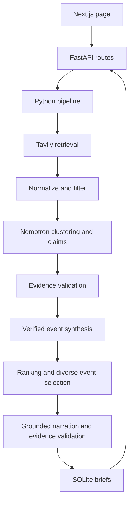

# DayBrief

A local news briefing prototype for the Nebius × NVIDIA Global AI Hackathon.
Choose General, AI & Technology, Science, or Macro & Policy to generate up to three source-backed event
cards and a roughly one-minute narration. Python 3.12, FastAPI, Pydantic v2,
SQLite, and Next.js with TypeScript. No agent framework. An optional video MVP is available (see below).

## Quick start

Requirements: Python 3.12+, Node 20.9+, npm, and network access for dependencies.

```bash
./dev.sh
```

Open http://localhost:3000; API docs: http://localhost:8000/docs.
The script creates a virtual environment, installs dependencies, and copies the
example environment into backend/.env **only when that file does not exist**.
The example explicitly enables mock mode. Existing settings are preserved.
Mock articles are fictional, timestamped relative to generation time; their
`.example` URLs intentionally do not resolve. The visible mock label distinguishes
these from real reporting. No paid requests are made in mock mode.

Manual setup (two terminals):

```bash
python3.12 -m venv .venv
.venv/bin/pip install -e './backend[dev]'
test -f backend/.env || cp .env.example backend/.env
cd backend
../.venv/bin/uvicorn daybrief.api:app --reload
```

```bash
cd frontend
npm ci
# Optional: set NEXT_PUBLIC_API_BASE_URL in .env.local before build/dev.
npm run dev
```

## Configuration

Backend reads environment variables and `.env` in its working directory.
Without explicit configuration, mode is **real**, with a clear 503 error when
credentials are missing. Never put keys in frontend variables or commit `.env`.

| Variable | Meaning |
| --- | --- |
| DAYBRIEF_MODE | Explicit `mock` or `real`; code default is `real` |
| TAVILY_API_KEY | Tavily API credential, backend only |
| TAVILY_BASE_URL | Tavily API root, default https://api.tavily.com |
| NEBIUS_API_KEY | Token Factory key, backend only |
| NEBIUS_BASE_URL | OpenAI-compatible API root ending in `/v1` |
| NEBIUS_MODEL | Model ID available to your Token Factory account |
| NEWS_LOOKBACK_HOURS | Default window, 24; 1–168 hours |
| DATABASE_URL | SQLite URL; default sqlite:///./daybrief.db |
| REQUEST_TIMEOUT_SECONDS | Timeout for each provider request, default 45 |
| CORS_ORIGINS | Comma-separated allowed origins; default http://localhost:3000 |
| NEXT_PUBLIC_API_BASE_URL | Frontend backend URL; default http://localhost:8000; embedded at build time |

For real mode, set `DAYBRIEF_MODE=real`, supply both keys, and confirm endpoint
and model availability in Token Factory. The example uses the endpoint and model
shown in [Nebius's official Nemotron example](https://nebius.com/services/token-factory/nemotron):
`https://api.tokenfactory.us-central1.nebius.com/v1` and
`nvidia/nemotron-3-super-120b-a12b`. Bearer auth and OpenAI-compatible
`/chat/completions` are used. No endpoint/model is guessed by the code.

[Tavily's official Search API](https://docs.tavily.com/documentation/api-reference/endpoint/search)
is called with Bearer auth, news topic, a date boundary, and publication dates.
The application applies the exact rolling hour window after retrieval. Missing,
invalid, or timezone-naive publication timestamps are discarded; retrieval time
is never substituted for publication time.

## Architecture



- `adapters.py`: provider transport, bounded retries, validated model responses;
  mock adapters return stage outputs, never a preassembled brief.
- `pipeline.py`: normalization, date filtering, clustering, extraction,
  verification, ranking, diversity selection, and narration assembly.
- `models.py`: forbidden extra fields, constrained enums/scores, HTTP URLs,
  timezone-aware dates, one to three selected events.
- `storage.py`: SQLite transactions and parameterized queries, no model calls.
- `api.py`: endpoints, explicit provider/configuration/storage errors and CORS.

Nemotron is central: it resolves event clusters, extracts and classifies claims,
assesses importance, and writes grounded narrative segments from verified event
summaries and supported confirmed claims. Python validates event ordering and claim
references; a structured evidence check must fully support every segment before
assembly. No critic or rewrite pass is used.
All claims retain source URL mappings; sources retain their timestamps and original
URLs in `original_url` alongside the normalized URL used for deduplication.

The conservative support gate requires each claim's exact text to occur in cited
snippets. Two distinct source hostnames are required to narrate it as a confirmed
fact. Single-source claims are downgraded and marked insufficiently corroborated.
Unsupported claims are retained for audit but excluded from the summary/narration.
`why_it_matters` is explicitly displayed as analysis. Sensitive keywords can raise
sensitivity independent of the model. Sensitive narration and card text are
checked for overt humor/exclamation markers and rejected when found. These
lexical checks cannot reliably detect every form of sarcasm.

## API

```bash
curl -s http://localhost:8000/health
curl -s http://localhost:8000/api/topics
curl -s http://localhost:8000/api/briefs/generate \
  -H 'Content-Type: application/json' \
  -d '{"topic":"ai_technology","lookback_hours":24}'
curl -s http://localhost:8000/api/briefs/BRIEF_ID
```

Success returns a validated Brief including events, claims, citation metadata,
script, estimated duration and mode. Invalid requests return 422 with FastAPI's
validation details; unavailable configuration/storage returns 503; provider or
editorial failures return 502; absent brief IDs return 404. Application errors use
`{"error":{"code":"...","message":"..."}}`. Provider secrets and raw
responses are never included in errors. Retries: up to three HTTP attempts for
network/timeouts/429/5xx with 0.25/0.5-second backoff; invalid model schemas get one
explicit retry, then fail. Authentication errors are not retried.

## Checks and builds

```bash
cd backend
../.venv/bin/ruff check .
../.venv/bin/ruff format --check .
../.venv/bin/pytest -q
```

```bash
cd frontend
npm run lint
npm run typecheck
npm run build
npm start
```

Optional browser smoke test (after building):

```bash
cd frontend
npx playwright install chromium
npm run test:smoke
```

It starts both services, generates a mock brief, checks three cards, narration,
source links, and mobile overflow. Chromium must be available.

No backend static type checker is configured for this prototype. Pydantic
validates boundary data at runtime. Duration is estimated from word count at
138 words/minute; actual delivery varies.

## Current limitations

- Real adapters require credentials; live paid provider integration was not
  exercised in the supplied environment.
- Tavily publication dates are provider estimates and can represent an update,
  rather than the original publication. ISO and RFC 2822 dates are supported.
- Extractive matching prioritizes safety over recall. Independent reporting may
  express the same fact differently, yielding a shorter edition or a 502 when no
  sufficiently corroborated events can be found. This is explicit, never a fake success.
- Different hostnames are only a heuristic for independence, not ownership or
  wire-service provenance verification. Source support does not prove truth.
- Clustering quality depends on Nemotron. Exact duplicate URLs are eliminated
  deterministically; model grouping handles differently worded coverage.
- Each mock topic has distinct fictional stories, including duplicate coverage,
  a single-source story, a sensitive event, and stale coverage. Fixture URLs are
  fictional and timestamps relative to request time.
- No scheduling, auth, payments, custom topics or external publishing.
- Synchronous SQLite is appropriate for local use; there is no distributed job
  queue, concurrency throttle, cancellation UI, or production rate limiting.
- Analysis/headlines remain model-authored and labeled; human editorial review
  is still needed for real publication. No semantic truth verifier is claimed.

Next milestone: evaluate clustering and evidence recall against a human-labeled
news corpus, add live-provider contract checks and provenance-aware evidence
verification. Keep video outside that milestone until factual quality is measured.


### Candidate source enrichment

Real-mode generation performs bounded event-specific searches after initial clustering.
Search hits are URL-deduplicated, filtered to the requested time window, and clustered
with the candidate again. Only hits grouped with every original member are accepted;
related events and results already owned by another candidate are not attached.
Claims still require verified evidence from at least two source hostnames.

`ENRICHMENT_MAX_CANDIDATES` (default `6`) and
`ENRICHMENT_QUERIES_PER_CANDIDATE` (default `2`) bound additional search calls.
Set either to `0` to disable enrichment. General prioritizes usable single-source
occurrences over explicit background pieces, preserving retrieval order on ties;
each candidate stops searching when it has three source hostnames or exhausts its
query budget. This is a coverage heuristic, not a guarantee of corroboration.
Supplemental provider errors retain the original sources and are logged.
Additional searches and clustering calls increase generation latency and API usage.

Pipeline logs distinguish clustering from extraction progress, report URL duplicates
and out-of-window articles, and include the failed stage and completed-event count.
Evidence logs report quote rejection and verification decisions. Initial `retrieved`
and `filtered` counters describe discovery; enrichment logs separately report added
articles. A brief can contain one to three events that pass the existing evidence
and category checks. Short editions include an API/UI `coverage_note`; zero safe
events still fail explicitly.

### Local provider cache

Search snapshots and schema-valid model outputs are cached as readable JSON files
under `.daybrief-cache/search/` and `.daybrief-cache/model/` (relative to the server's
working directory). Search files include the raw results and parsed articles;
model files include the input, schema, instructions and structured output.
Credentials are excluded. Files are ignored by Git.

Caching defaults to enabled with a one-hour lifetime. Configure
`PROVIDER_CACHE_ENABLED=false` to bypass reads and writes,
`PROVIDER_CACHE_DIR` to choose a directory, and
`PROVIDER_CACHE_TTL_SECONDS` to change the lifetime. Remove the cache directory
when a complete refresh is needed. Disabling does not delete existing snapshots.
Expired snapshots are replaced on the next successful request.

Identical requests reuse disk snapshots across server restarts. Search keys include
the query, topic, lookback, start date, result limit and endpoint; model keys include
the stage, exact input, model, endpoint, schema and stage instructions. Changed
inputs or expired entries trigger provider calls. Publication-time filtering still
uses the current run time, so a cached search can lose articles as they age out.
This is a request cache, not a frozen replay of an entire historical run. Failed
requests and schema-invalid model outputs are not cached. Cluster membership is
also validated before saving and when reading cached output. Missing, duplicate,
unknown article IDs or empty groups invalidate the cache and are fed back to the
model for a bounded repair (at most two generation attempts). Repeated failures
are not cached. Other downstream evidence checks still apply. Cache logs include paths.

### Evidence repair and cached-search replay

Extraction now cites short source IDs (`s0`, `s1`, ...) rather than generating URLs.
The application resolves IDs to the exact input article URLs. Unknown IDs are
rejected. After initial verification, events with multiple source hostnames get
a deterministic scan for already-verified quotes appearing in other source snippets,
followed by at most one model evidence-repair pass for up to six under-supported
factual claims. Cross-source quote matches are independently verified before use.
Repair searches the existing snippets; it cannot change claim text/classification,
and every added quote must pass both exact snippet matching and semantic verification.
Previously verified evidence is retained if repair fails. Additional snippets from
an already-owned URL in the current candidate are retained as excerpts from the
same source, never counted as another source.

To replay a stored search run (from the `backend` directory):

```bash
python -m daybrief.replay --seed .daybrief-cache/search/INITIAL_SEARCH_FILE.json --output .daybrief-cache/replays/my-run
```

Use the initial broad-search snapshot as the seed. For new market runs, any of the
three discovery-lane snapshots can be the seed; replay reads all three matching
queries from the same directory. Old single-query market seeds remain readable,
but newly generated supplemental queries need their own snapshots to replay.
Replay fixes the time window to
its retrieval time and reads supplementary searches only from neighboring snapshot
files. Missing search snapshots return no results and are listed in the report;
Tavily is never called. Nebius may be called for uncached model analysis, using the
normal credentials and cache configuration. Output contains `run.log`, `summary.json`
with all final events, and `brief.json` only if selection and generation succeed.
Replay does not save a brief to the application database.


### Market discovery and reserve events

Macro & Policy (API topic ID `markets`) uses three concurrent discovery queries:
inflation/GDP/employment data, central-bank monetary policy, and fiscal policy/public
debt/international trade. Ranking prioritizes economy-wide developments over individual
stock moves and corporate earnings. Each requests
up to 10 results. Results are interleaved, normalized, URL-deduplicated and filtered
before clustering. A failed lane is logged; successful lanes can still proceed.
Repeated URLs retain distinct snippets without becoming extra independent sources.

Supplemental queries are built locally from the seed reporting: company name, explicit
ticker, explicitly stated quarter/year, or a concrete policy/event. Publisher suffixes
and common headline boilerplate are removed. A reporting date is not invented from
the article publication date. Query planning does not call a model.

Unmatched supplemental articles enter a bounded pool. After enrichment, the pool is
clustered together with retained candidates to reconcile rediscovered events. Existing
events must remain intact; reconciliation failure retains the original candidates.
Only additional groups with at least two hostnames enter the reserve list. They are
extracted and verified when the primary events cannot fill three eligible, diverse
stories. Existing evidence requirements remain unchanged; no extra search loop is added.

- `FALLBACK_MAX_ARTICLES=40`: maximum unmatched articles retained for reconciliation.
- `FALLBACK_MAX_CANDIDATES=6`: maximum reserve groups, preferring greater source coverage.
- Set either to `0` to disable reserve processing.

Logs identify `market_discovery_lane`, `fallback_candidates`, reserve promotions and
cache invalidations. Discovery uses up to three search requests; supplemental search
still obeys `ENRICHMENT_MAX_CANDIDATES × ENRICHMENT_QUERIES_PER_CANDIDATE`.
Reserve reconciliation adds at most one clustering stage, excluding bounded retries,
and only promoted reserve events incur extraction/verification calls.

Macro & Policy evidence enrichment uses the existing enrichment budget: at most
one event-level search per prioritized candidate, then the remaining
`ENRICHMENT_QUERIES_PER_CANDIDATE - 1` searches after extraction and verification.
With the default of two, this is one event search plus one fact search. Explicit
previews, historical explainers, opinion and market-summary headlines are retained
but do not consume enrichment searches. This title-based filter is a conservative
heuristic, not a complete semantic news classifier.

The fact search targets an uncorroborated core confirmed fact and excludes existing
source hostnames. New results must pass publication-window filtering, event
membership, verbatim quotation and evidence verification. A verified core fact
supported by two hostnames stops further fact searches; source count alone does
not stop this phase. `is_core=false` background facts cannot qualify an event.
Hostname diversity remains a proxy for independent sourcing, not syndication
or ownership detection. Failed supplemental searches retain existing evidence.
Changed extraction instructions/schema require new model cache entries; old
search snapshots alone cannot establish the new flow's real-world success rate.

## Video MVP

Install backend extras with `pip install -e './backend[video]'` from the project
root (or `pip install -e '.[video]'` inside backend). Install `ffmpeg` and `ffprobe`
on PATH. Set `VIDEO_FONT_PATH` to a Unicode TrueType font when the default macOS
Arial / Linux DejaVu font is unavailable. Output is 1080×1920 H.264/AAC MP4 with
burned-in Pillow subtitles, so FFmpeg libass is not required.

Azure is disabled by default. Keep `AZURE_SPEECH_KEY`, `AZURE_SPEECH_REGION` and
`AZURE_SPEECH_VOICE` in backend environment variables only. Explicitly set
`AZURE_SPEECH_ENABLED=true` to enable paid synthesis. The UI also requires an
unchecked-by-default consent checkbox; creating/retrying via API requires
`{"allow_paid":true}`. No video is created automatically with a brief.

- `POST /api/briefs/{brief_id}/videos`: enqueue an Azure video task (202).
- `GET /api/videos/{job_id}`: status, stage, progress and sanitized error.
- `POST /api/videos/{job_id}/retry`: create a new task for a failed task.
- `GET /api/videos/{job_id}/file`: stream completed MP4, supports range requests.
  Append `?download=true` for download.

Jobs persist in a separate SQLite table; brief rows are never modified. Run a
single API worker for this MVP: one in-process video worker serializes rendering.
On server restart, unfinished jobs are marked failed and can be retried. Successful
speech segments are cached by provider, voice and exact narration so render retries
reuse them. Failed/incomplete speech requests may still have incurred provider
charges. Artifact/audio folders contain narration and are ignored by Git.

The narration must contain opening, one paragraph per selected story, and
closing. New briefs store narrative segments and supporting claim IDs after evidence
validation. Video splitting checks segment order, eligible/core references, exact
agreement with saved narration, and an application-generated evidence digest.
Legacy briefs without segments still require exact confirmed/supported claim text.
No news retrieval or model call occurs during video splitting. Each scene uses ffprobe-measured audio duration; Azure word
boundary offsets drive subtitles. If timing is absent, captions use explicitly
marked estimated timings. `manifest.json` records texts, cues and durations.
Hard cuts separate scenes; the closing is synthesized and rendered like every other
scene. Preview/opinion facts are not regenerated for video.

For a **non-Azure local smoke test on macOS**, run from backend:

```sh
python -m daybrief.video --brief-id SAVED_BRIEF_ID --local-test
```

This explicitly uses macOS Samantha speech and estimated captions, not Azure.
Inspect the five scenes, transitions, last spoken word and ending in the generated
MP4 under `.daybrief-videos/JOB_ID/`. This test cannot validate Azure voice quality
or Azure word-boundary behavior. Real Azure validation needs separate paid-service
consent. The MVP uses the existing local API access model; do not expose the paid
endpoint publicly without authentication/rate limits.

## Docker local development and future VM deployment

The container entry point is http://127.0.0.1:8080. Pages, `/api/*`, and `/health`
share the same origin. Only Nginx publishes a host port; frontend and backend
communicate through the Compose network. Proxy read/send timeouts are 1800 seconds
for long briefing requests; these are not an overall task deadline.
Compose defaults to mock mode and explicitly overrides the mode in backend/.env
to prevent unintended paid provider calls.

### Prerequisites and configuration

Install and start Docker Desktop for Apple Silicon, or Linux Docker Engine with
Compose v2.24+. Network access is required to download base images and dependencies.
The host does not need Node or Python to run the containers; the verification script
requires Python 3. If docker is not on your Mac's PATH, use
`export PATH="/Applications/Docker.app/Contents/Resources/bin:$PATH"`.

- `compose.yaml`: builds, networking, health checks, startup dependencies, restart
  policies, and persistent storage.
- `backend/.env`: optional backend runtime credentials. **Preserve existing files.**
  The conditional copy below creates it only if missing. Use `docker compose config
  --quiet`; plain `docker compose config` can display resolved credentials.
- `.env.example`: backend configuration template without real credentials; also
  includes the frontend API address for traditional local development.
- `deploy/compose.env.example`: non-sensitive Compose mode/port settings. Use with
  `docker compose --env-file deploy/compose.env.example ...`.
- The container frontend builds with `NEXT_PUBLIC_API_BASE_URL=""`. Both call sites
  use `??`, preserving an empty value for same-origin relative requests. An unset
  value retains the existing localhost development fallback. This setting is
  embedded at build time; runtime changes do not alter browser code. Frontend
  builds do not load the host's `.env.local`.
- API keys are injected only through the backend runtime env_file. They are not
  passed to the frontend or build steps. To explicitly enable real news, configure
  backend credentials, then run `DAYBRIEF_MODE=real docker compose up -d`.

Run from the project root (existing .env files are preserved):

```bash
export PATH="/Applications/Docker.app/Contents/Resources/bin:$PATH"
test -f backend/.env || cp .env.example backend/.env
export DAYBRIEF_MODE=mock
docker compose config --quiet
docker compose up -d --build --wait --wait-timeout 180
curl --fail http://127.0.0.1:8080/health
# Open http://127.0.0.1:8080 in your browser.
python3 scripts/docker-smoke.py
```

The verification script forces mock mode and checks the homepage, proxied API/health
routes, and absence of internal API addresses in browser JavaScript. It generates
and retrieves a brief, rebuilds and forcibly recreates the containers, then retrieves
the original ID and compares the complete data. It adds one fictional test brief,
prints service logs, and leaves services running with their data intact.
It is not a browser automation test and does not verify UI interactions or video synthesis.

### Operations and data

```bash
docker compose ps
docker compose logs -f --tail 100
docker compose logs --tail 100 backend frontend proxy
docker compose stop                 # Stop services; retain containers and data.
docker compose start                # Start existing containers.
docker compose down                 # Remove containers/network; retain named volumes.
# Rebuild and start after updating the project code.
docker compose up -d --build --wait --wait-timeout 180
```

`docker compose down -v` **deletes named volumes, including all briefs, video jobs,
audio/video files, and caches**. Use it only when you intend to erase the data,
never as a routine update or troubleshooting step.

The named volume `daybrief_daybrief_data` mounts at `/data`. The database URL is
`sqlite:////data/daybrief.db`, an absolute path compatible with the existing Storage
implementation. `/data/videos` holds existing video artifacts and audio caches;
`/data/cache` holds provider caches. New volumes inherit directory write permissions
for UID 10001 from the image. The backend runs as this non-root user; the frontend
runs as the node user. The host's existing backend/daybrief.db is not migrated
automatically, preserving local development data.

The backend image includes pinned Pillow and Azure Speech SDK dependencies, FFmpeg,
FFprobe, Linux SDK runtime libraries, and DejaVu fonts. Both Compose files read
`AZURE_SPEECH_ENABLED` from backend/.env; the application defaults to disabled.
The image build runs an offline prerequisite check without credentials or TTS calls.

Create a consistent backup by stopping writes and exporting the entire data directory,
including audio/video files:

```bash
mkdir -p backups
docker compose stop backend
docker compose run --rm --no-deps -T backend tar -C /data -czf - . > backups/daybrief-data.tar.gz
docker compose start backend
```

Restore into an empty volume. Verify the backup first and do not overwrite data
that you still need:

```bash
docker compose stop backend
docker compose run --rm --no-deps -T backend tar -C /data -xzf - < backups/daybrief-data.tar.gz
docker compose start backend
```

### Architectures and dependencies

The backend uses Python 3.12 slim, installs `requirements.lock.txt`, and runs
`pip check`. Existing exact dependency pins are preserved, including pytest/ruff.
The frontend uses Node 24 LTS, satisfying the installed Next.js 16.4.2 requirement
of `node >=20.9.0`. It uses the existing package-lock.json with `npm ci`, builds
standalone output in multiple stages, and runs `node server.js` in production.
The [official Node release schedule](https://github.com/nodejs/Release) documents
LTS support periods. Both services listen on 0.0.0.0. The backend uses one worker
to remain compatible with existing video job recovery. Docker ignore allowlists
exclude credentials, virtual environments, node_modules, Mac native binaries,
databases, and build caches.

The selected official Python/Node/Nginx images provide arm64 and amd64 variants.
Compose does not specify a platform: Apple Silicon uses native arm64, and a future
Nebius x86_64 VM uses native amd64. No VM was created and no image was published.
On the VM, copy the project without local virtual environments or node_modules,
securely configure the backend environment file, and run the same
`docker compose up -d --build` command. The entry point still binds to the VM's
127.0.0.1 by default. Connect from your Mac with:

```bash
ssh -L 8080:127.0.0.1:8080 USER@VM_IP
```

To publish multi-architecture images in the future, run the following manually,
replacing REGISTRY. These commands were not executed during this task:

```bash
docker buildx create --name daybrief-multi --use
docker buildx build --platform linux/arm64,linux/amd64 -t REGISTRY/daybrief-backend:VERSION --push backend
docker buildx build --platform linux/arm64,linux/amd64 -t REGISTRY/daybrief-frontend:VERSION --push frontend
```

Then configure the corresponding `image:` for each service in a deployment Compose
override, run `pull`, and run `up -d --no-build`. For production releases, pin base
and application images by digest. Current tags allow updates; application dependency
versions are fixed by lockfiles. amd64 builds still require actual verification on
the target platform or through Buildx.

### Troubleshooting and verification limits

- Docker socket/daemon unavailable: start Docker Desktop, check `docker version`
  and `docker context show`, and confirm that the terminal or execution environment
  has permission to access the Docker socket.
- Dependency downloads fail: inspect build logs and registry connectivity. Do not
  delete lockfiles to bypass errors.
- Unhealthy services or 502 responses: run `docker compose ps` and the per-service
  log commands above. Check backend data permissions and frontend startup status.
  The proxy resolves service addresses dynamically through Docker DNS after
  container replacement.
- Port already in use: run `DAYBRIEF_PORT=8081 docker compose up -d` and use that
  entry port.
- Real mode returns 503: check required settings in backend/.env. Never put
  credentials in NEXT_PUBLIC variables.
- Browser requests localhost:8000: confirm that you are using the Compose entry
  point, rebuild the frontend, and refresh the browser cache.

Verification completed during containerization: `docker compose config --quiet`
passed; the local Next.js production build with an empty API base passed; all 107
backend tests passed with one Starlette/httpx deprecation warning. Additional mock
API checks verified health, generation, retrieval by ID, and SQLite persistence
across application restarts. npm manifest dependencies match the lockfile root,
and pip check passed. The local build used host Node 25.8.1, so it does not validate
Node 24 inside the image.

The Docker CLI was found, but the sandbox blocked socket access and the escalation
request was denied. **Image builds, container startup, actual proxy/homepage HTTP
requests, container runtime logs, and volume persistence across container recreation
were not verified.** Docker runtime success cannot be claimed. Run the verification
script above once Docker engine access is available to complete these checks.


A subsequent clean Docker build exposed a peer dependency conflict: the existing
`eslint-config-next` 14 package did not support ESLint 9. The frontend now pins
`eslint-config-next` to 16.4.2 to match the locked Next.js version, uses its native
flat configuration, and includes a regenerated package-lock.json. A clean `npm ci`
and local production build passed after this fix. Lint passed with one existing
`react-hooks/exhaustive-deps` warning in VideoPanel.tsx. No `--force` or
`--legacy-peer-deps` workaround is required. The Docker build still needs to be rerun.

## Deploy from a Mac to a single Nebius VM

`deploy.sh` builds Linux amd64 images locally using the existing Dockerfiles,
exports them with `docker save`, transfers them over SSH/scp, loads them on the VM,
and starts `docker-compose.prod.yml`. The Nginx image is included in the archive;
the VM does not build images or pull them from a registry. No secrets are uploaded.

Prerequisites:

- Mac: running Docker Desktop with Buildx and amd64 emulation, Docker 28+ (for
  `docker image save --platform`), SSH/scp, and enough disk space for image export.
- VM: Ubuntu x86_64, Docker Engine, Compose v2 with `up --wait`, curl, sufficient
  disk space, and Docker access for the SSH user without interactive sudo.
- SSH authentication must already work. Host keys use your normal SSH settings.
- Maintain `~/daybrief/backend/.env` directly on the VM before the first deployment.
  Set `DAYBRIEF_MODE=mock` for an initial test or `DAYBRIEF_MODE=real` with the
  required Tavily/Nebius settings for real news. The script does not create,
  upload, display, or overwrite this file. Production mode comes from this file,
  not from the Mac's environment. Azure video generation is opt-in via this file.

From the repository root:

```bash
VM_HOST=<vm-ip> ./deploy.sh
# Optional overrides; quote ~/... so the VM resolves its own home directory.
VM_HOST=<vm-ip> VM_USER=ubuntu REMOTE_DIR='~/daybrief' ./deploy.sh
```

`VM_USER` defaults to `ubuntu`; `REMOTE_DIR` defaults to `~/daybrief`. The directory
must be an absolute path or start with `~/`, without spaces or shell metacharacters.
The script uploads only the image archive, production Compose file, and existing
Nginx configuration. Temporary archives are removed after use; Docker images remain
available locally and remotely. Run deployments sequentially: deployment image tags
and remote configuration paths are reused.

Production preserves the `backend`, `frontend`, and `proxy` service names and uses
the fixed Compose project `daybrief` and named volume `daybrief_daybrief_data`.
Existing data in that volume is reused; a new VM gets a new empty volume. Data from
your Mac is not copied. If an earlier VM deployment used a different project or
volume name, adjust the production volume name before deploying to reuse its data.
Updates recreate changed containers without deleting volumes. No `down` or volume
removal command runs. Updates can briefly interrupt requests; automatic rollback
is not implemented.

Only the proxy publishes a port: `8080:8080`. Backend/frontend remain internal;
this application uses SQLite and has no Postgres or Redis service. Existing
same-origin `/api/*` and `/health` routing and long-request timeouts are preserved.
Allow inbound TCP 8080 in the VM firewall/security group for external access.
The script does not change firewall rules. The existing app has no authentication;
restrict access to your intended clients. This workflow serves HTTP without TLS.

The script waits for service health, prints `docker compose ps`, and checks
`http://127.0.0.1:8080/health` on the VM without generating a paid brief. It then
prints `http://<vm-ip>:8080/`. To check external reachability from your Mac:

```bash
curl --fail --show-error http://<vm-ip>:8080/health
```

For logs or status on the VM:

```bash
ssh ubuntu@<vm-ip>
cd ~/daybrief
docker compose -p daybrief -f docker-compose.prod.yml ps
docker compose -p daybrief -f docker-compose.prod.yml logs --tail 100
```

The deployment workflow has been checked locally for shell syntax, Compose
configuration, and command sequencing using simulated Docker/SSH/scp commands.
An actual amd64 build, image transfer, and VM deployment have not been performed
as part of adding this workflow.


### Grounded final narration

P2 first calls `script_select` with event IDs and eligible supported, confirmed-fact
claims (IDs, text, and core flags). Its strict `NarrativeSelectionPlan` selects one
or two claims per event, prioritizing the core occurrence and at most one
complementary, nonredundant concrete fact. Python validates event mapping, unique
claim IDs, eligibility, and at least one core claim before writing begins.

The final `script` stage receives ONLY the selected claim IDs/text/core flags,
event IDs, and word budget. It receives no P1 summary, headline, raw snippets,
unselected claims, or broader analysis/uncertainty. P1 summaries remain produced
and stored upstream, but are excluded from both P2 model inputs.

The writer returns the existing `NarrativePlan`: one to three ordered segments,
each with one spoken paragraph and `supporting_claim_ids`. Python requires those
IDs to match the frozen selection exactly, including order; additions, omissions,
and substitutions fail before semantic verification. The saved brief and narrative
schemas remain unchanged. Claim selection adds one structured model call per brief;
it does not add a critic/rewrite pass.

A separate `narrative_verify` evidence gate uses the existing structured verification
pattern to check the entire segment against its cited claims, including qualifications,
core-event coverage, numerical consistency, and appropriately qualified interpretation.
Every segment must receive exactly one `full` result. `claim_index` identifies the
narrative segment, not a supporting claim; even a segment with two supporting claims
requires only one check, with `evidence_index=0`.

Extra, missing, duplicate, or invalid result indices trigger the existing structured
response retry (at most two generation attempts), with expected/received mappings in
correction feedback. Cached responses undergo the same mapping validation. Exhausted
mapping failures are reported as `narrative_verifier_mapping_failed`. Valid mappings
with partial, contradictory, or negative verdicts fail as `narrative_grounding_failed`
without retrying for a more favorable verdict. There is no rewrite or prose fallback.

Narration targets are computed after claim selection. For each event, count the
selected claim words and add `min(3, ceil(words * 0.1))` connective words. Cap this
soft target at an equal share of the overall narrative word ceiling. There is no
minimum target or minimum-duration rejection: a 12-word claim gets a 14-word soft
target, and a faithful 12-word segment is accepted if grounding passes. The writer
is explicitly instructed to prefer short faithful sentences over padding and never
to invent availability, audience, pricing, timing, causality, significance, or scale.

The existing upper limits remain: 25/50/75 seconds for one/two/three stories, at
2.3 words/second (57/114/172 total words, including ten boilerplate words). The total
soft target is the sum of event targets plus boilerplate. Shorter is acceptable;
all accepted segments must still receive a `full` grounding verdict. Model/prompt/
schema changes use new cache keys; no database migration is required.

Narrative segments and an evidence digest are persisted with each new brief. The
digest detects accidental changes to segment text or stored claim evidence; it is
not a signature or protection against someone who can rewrite the database and
recompute it. The semantic evidence gate uses the same configured model and can
still make mistakes; claim references alone do not prove entailment or source truth.
Production quality and latency have not been evaluated with paid model calls.


### Enable Azure video in Docker

Maintain these settings in `backend/.env` on the machine running the containers
(on the VM, normally `~/daybrief/backend/.env`). Preserve other existing settings:

```dotenv
AZURE_SPEECH_ENABLED=true
AZURE_SPEECH_KEY=YOUR_SPEECH_RESOURCE_KEY
AZURE_SPEECH_REGION=westus2
AZURE_SPEECH_VOICE=en-US-JennyNeural
```

Use the region belonging to your Speech resource. For the Azure resource endpoint
`https://westus2.api.cognitive.microsoft.com/`, configure `westus2`, not the URL.
The SDK uses the resource key and region. No custom endpoint setting is required.
Never commit keys. Compose does not override the Speech enable flag; missing settings
default to disabled. `VIDEO_FONT_PATH` can remain empty to use the included DejaVu font.

Rebuild locally with `docker compose up -d --build`, or deploy the updated image with
`./deploy.sh -i VM_IP -u mac-mini`. The script does not upload backend/.env.
If only VM runtime settings changed, recreate the backend from the VM directory:

```bash
docker compose -p daybrief -f docker-compose.prod.yml up -d --force-recreate backend
# Offline prerequisite check; does not validate Azure credentials or consume quota.
docker compose -p daybrief -f docker-compose.prod.yml exec backend python -m daybrief.video_check
```

Open a saved brief, select the Azure synthesis consent checkbox, and click Generate
video. This explicitly contacts Azure and may consume quota or incur charges according
to the resource tier; the application cannot determine whether the key is F0 or S0.
Mock news mode does not disable an explicitly authorized Azure video request. Video
artifacts and audio caches stay in the existing `/data/videos` persistent volume.
Do not use `down -v`. Keep one backend worker for the existing in-process video queue.

The dependency setup follows the
[Microsoft Speech SDK Linux prerequisites](https://learn.microsoft.com/en-us/azure/ai-services/speech-service/quickstarts/setup-platform).


### General discovery and shorter safe editions

General discovery uses three concurrent Tavily queries (world affairs, economy/policy,
and science/technology/health/environment), each requesting up to 10 results. Results
are interleaved before existing URL deduplication, publication filtering, and clustering.
This targets up to 30 raw articles, not 30 distinct or eligible events. Failed lanes
are logged; successful lanes survive. Snapshot replay recognizes the new General
lanes and keeps support for older single-query snapshots.

Enrichment retains its existing bounded budgets: six candidate events, two searches
per candidate, six reserve candidates, and 40 reserve articles by default. Concrete,
nonempty single-source candidates receive priority over background pieces. This is
a deterministic prioritization heuristic, not a new relevance or evidence classifier.
Extraction explicitly requests the atomic central occurrence before background facts.
Malformed fallback clustering still fails closed and retains original candidates.

Selection prefers up to three fully corroborated stories, preserving category limits.
Each selected event has `corroboration_level="independently_corroborated"`. The default
`"unverified"` supports old saved payloads without retroactively asserting verification.
When only one or two stories qualify, the response includes `coverage_note`, the UI
shows the actual story count, and narration targets follow selected evidence length. All
claim-reference and semantic narration verification checks still apply.

Single-source Tier 2 stories are **not enabled**. The current claim status combines
semantic evidence support with source count: one fully supporting source still means
`partially_supported`, and extracted confirmed facts are downgraded to `reported_claim`.
Allowing those through would change existing safety semantics. A future Tier 2 design
needs separate semantic-support and corroboration fields, explicit source attribution,
and end-to-end validation; no partial or unsupported claims are promoted here.

Three discovery requests and a larger candidate pool can increase provider usage and
latency. More retrieval improves the opportunity for corroboration but cannot guarantee
three safe stories. Distinct hostnames remain the existing independence proxy; they
do not establish that syndicated reports have independent reporting origins.
